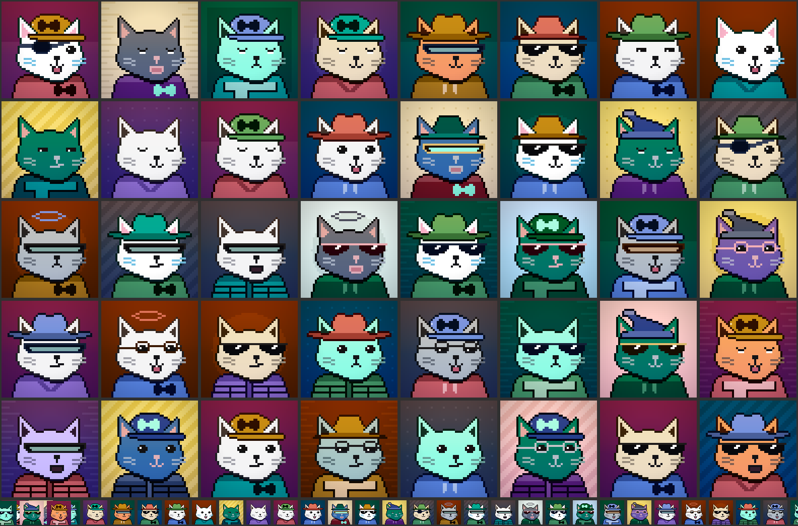
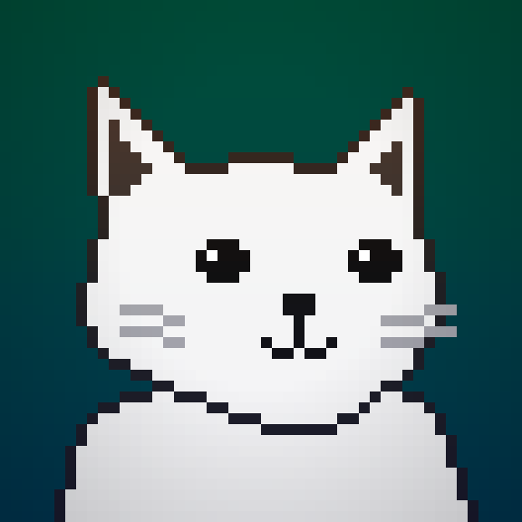

# Hyper Identicons

[](https://github.com/chase-mew/hyper-identicons/actions/workflows/ci.yml)
[](https://www.npmjs.com/package/hyper-identicons)
[](https://www.npmjs.com/package/@hyper-identicons/react)
[](LICENSE)
[](LICENSE-ART)

A deterministic pixel-art cat for every HyperEVM address. The same address always
renders the same character, in any app, with no network call, no account and no
upload.



> **Spec v1 is a draft and the output is not frozen.** Any address may render
> differently between releases until `spec/v1.md` says Frozen. Don't ship this to
> users who will grow attached to their avatar yet.

## Install

Packages: [hyper-identicons](https://www.npmjs.com/package/hyper-identicons) ·
[@hyper-identicons/react](https://www.npmjs.com/package/@hyper-identicons/react)

```sh
npm install hyper-identicons
npm install @hyper-identicons/react   # optional React wrapper
```

## Use it

```ts
import { identicon, identiconUri } from 'hyper-identicons';

const address = '0xd8dA6BF26964aF9D7eEd9e03E53415D37aA96045';

identicon(address);                                // an SVG string
identiconUri(address, { size: 40, radius: 24 });   // a data: URI, ready for an 
```

```tsx
import { HyperIdenticon } from '@hyper-identicons/react';

<HyperIdenticon address={address} size={32} detail="mini" />;
```

Four functions, all taking an address with or without `0x` and in any casing:

| Function | Returns |
|---|---|
| `identicon(address, options?)` | an SVG string |
| `identiconUri(address, options?)` | the same SVG as a `data:` URI |
| `identiconOf(address)` | the pixel grid and the traits behind it |
| `identiconTraits(address)` | just the traits, without rendering |

`options` are `size` (CSS pixels; omit for a scale-free SVG), `radius` (0–24 in canvas
units, where 24 is a circle) and `title` (an accessible name, escaped for you). An
address that isn't 20 bytes of hex throws `InvalidAddressError`; `isAddress` checks
without throwing, and the React component renders its `fallback` instead.

Importing from `hyper-identicons/mini` gives you the same four functions painting
background, body, eyes and headwear only. It agrees with the full renderer on every
layer they share, so an address is recognisably the same character either way, and the
art it drops never reaches your bundle.

Algorithm primitives (`selectTraits`, RLE, `renderPixels`, …) live on
`hyper-identicons/core`. Art data and trait metadata (`ART_DATA`, `MANIFEST`,
`COLORWAYS`) live on `hyper-identicons/art`. Neither is needed for ordinary use.

## Why it is built this way

**Rendered locally, not fetched.** Wallets and explorers draw a hundred avatars in a
scrolling list; none of them will accept a network request per row, and an address
lookup service would learn who is watching whom. The library is the product.

**Art is run-length encoded pixel data, not PNGs or hand-drawn SVG.** Artists still
draw pixels; a build step compresses them. All 32 assets come to 5.7 KB of base64.

**One body silhouette, many colourways.** Shape and colour are drawn independently, so
a garment is drawn once and composites onto every cat by construction. Thirteen fur
colourways cost one drawing, and there is no class of bug where a hoodie fits one body
and not another.



**Legibility is guaranteed, not hoped for.** Fur and backgrounds are split into a deep
band and a bright band with a wide gap between them, and the background is always drawn
from the band the cat did not take. No address can produce a cat that sinks into its
own backdrop. `AGENTS.md` has the reasoning and the numbers,
`packages/hyper-identicons/scripts/audit-colors.ts` prints them, and the test suite
enforces them.

**Every cat carries the same wash.** Each layer picks its colourway independently,
which makes any one cat coherent and a list of them a jumble, so a warm-over-cool split
tone and a soft vignette go over the finished art — the miniature painter's trick for
making a squad painted across several sittings look like one squad. It is part of the
render rather than a CSS filter, so it survives whatever the caller does with the SVG,
and it is zero across the face, so it costs none of the contrast above.

## Layout

| Path | What it is |
|---|---|
| `packages/hyper-identicons` | The library: engine, art data, both entry points. |
| `packages/react` | `<HyperIdenticon />`. |
| `apps/playground` | Address inspector, legibility sheet, trait explorer. |
| `spec/v1.md` | The normative spec. Any port must match it byte for byte. |
| `spec/vectors.json` | Addresses pinned to their traits and output hashes. |
| `tools/` | The Python generators that draw the art. |
| `AGENTS.md` | Working notes: the art pipeline, the colour system, known gaps. |

Inside the library, `src/core` is the engine and knows nothing about cats;
`art-source/` holds the pixel grids; `src/art/` is generated from them and is not
edited by hand. The grids themselves are generated too — `make-body.py` draws the cat
and publishes its landmarks to `tools/anchors.json`, and `make-traits.py` reads those
anchors and places everything else against them, which is what stops the body and the
things worn on it drifting apart.

The cat is a three-quarter view, which drives more of the layout than it looks. The
skull is centred on column 23 but the muzzle sits four columns right of it, so anything
landing on the face carries a `shift`. The near ear is drawn in full and the far one is
foreshortened. `tools/peek.py` prints a labelled sub-rectangle of any grid, which is
the fastest way to read exact coordinates.

## Working on it

```sh
pnpm install
pnpm dev          # playground on :5173
pnpm build        # re-encode the art, then compile both packages
pnpm typecheck
pnpm test
```

`CONTRIBUTING.md` covers which files are generated, how to add a trait, and what to
check before you believe a colour works.

## Porting it

`spec/v1.md` is normative and self-contained: address normalisation, seeding, weighted
selection, the tone-pairing rule, the art encoding, and the render including the wash.
`spec/vectors.json` pins 32 addresses to their traits and to SHA-256 hashes of their
output, so a port can prove it agrees rather than assert it.

## Licence

Code [MIT](LICENSE). Art [CC0](LICENSE-ART) — copy it, fork it, ship it, no attribution
required.

The art is original. This project is unofficial and unaffiliated with any protocol,
exchange or foundation.
